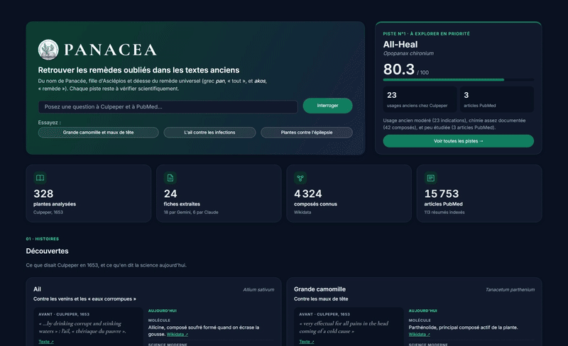

# Panacea

*Retrouver les remèdes oubliés dans les textes anciens.*



Panacea analyse un traité ancien de plantes médicinales, *The Complete Herbal*
de Nicholas Culpeper (1653, domaine public, Projet Gutenberg n° 49513). Elle en
extrait des connaissances, les croise avec la chimie (Wikidata) et la recherche
moderne (PubMed), et repère des pistes de principes actifs. Le nom vient de
Panacée, fille d'Asclépios et déesse du remède universel.

> Ceci n'est pas un avis médical.

## Structure

```
app/main.py           interface Streamlit (4 onglets)
src/download.py       étape 1 : téléchargement du texte (Gutenberg)
src/parse_herbal.py   étape 1 : nettoyage et découpage par plante -> data/plants.json
src/extract.py        étape 2 : extraction structurée (Gemini)     -> data/extracted.json
src/enrich.py         étape 3 : composés chimiques (Wikidata)      -> data/enriched.json
src/score.py          étape 4 : score de piste (PubMed)            -> data/leads.json
src/graph.py          étape 5 : graphe de connaissances            -> data/graph.html
src/rag.py            étape 6 : questions-réponses (BM25 + embeddings + Gemini)
data/cache/           réponses des API mises en cache
data/index/           index de recherche (reconstruit si une source change)
models/               modèle d'embeddings local (téléchargé une fois)
```

## Installation (Windows / PowerShell)

```powershell
python -m venv .venv
.\.venv\Scripts\Activate.ps1
pip install -r requirements.txt
```

Copiez `.env.example` en `.env` et renseignez `GEMINI_API_KEY` (clé gratuite sur Google AI Studio).
Le fichier `.env` n'est jamais versionné.

Au premier lancement de la recherche, le modèle d'embeddings
(`sentence-transformers/paraphrase-multilingual-MiniLM-L12-v2`, ~470 Mo) est téléchargé
depuis Hugging Face, puis l'index est construit dans `data/index/` (non versionnés).

## Lancer l'application

```powershell
.\.venv\Scripts\streamlit run app/main.py
```

L'application s'ouvre sur http://localhost:8501. Sans clé ou quota Gemini, l'onglet
Questions bascule en mode de secours (passages les plus pertinents et leurs sources).

## Relancer le pipeline

```powershell
python src/parse_herbal.py   # 1. plantes
python src/extract.py        # 2. fiches (Gemini, 20 plantes sélectionnées)
python src/enrich.py         # 3. composés
python src/score.py          # 4. classement
python src/graph.py          # 5. graphe
python src/rag.py --build    # 6. index de recherche
python src/rag.py "Quelles plantes contre la jaunisse ?" --no-llm
```

Chaque étape lit la précédente et met ses appels réseau en cache : une relance ne
refait aucun appel déjà effectué.
